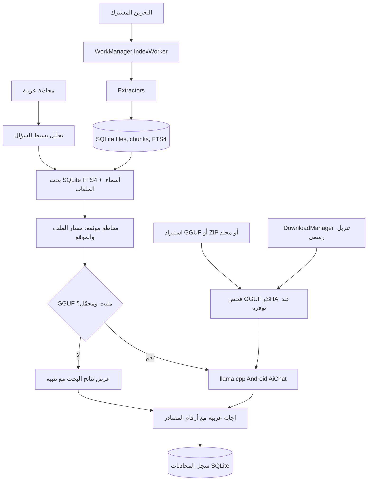

# التصميم التقني V0.1

## قرارات الأداء

1. لا تجرِ عملية معالجة PDF أو أرشيف داخل Thread الواجهة.
2. 75 صفحة PDF و240 ألف حرف كحد افتراضي للحماية من الاختناق؛ قابل للتعديل في `Extractors.kt`.
3. تحديث الملفات يعتمد على الحجم + وقت التعديل حاليًا، لا بصمة كاملة لتوفير I/O. يجب إضافة fingerprint تدريجي في إصدار لاحق.
4. FTS4 بدلاً من FTS5 لدعم SQLite المدمجة في Android دون حزم إضافية.
5. تشغيل نموذج واحد بواسطة `AiChat` عند استخدام المحادثة، وعدم تحميل نموذج الصوت والرؤية في هذه النسخة.
6. تُعرض حالة «بيانات وصفية» ولا تدعي التطبيق فهم محتوى صور أو تسجيلات لم تُعالج.

## تحسينات مرحلية

- v0.2: استرجاع دلالي عبر E5 INT8 على ARM64 + hybrid RRF + إثراء فهرس المحادثات.
- v0.3: OCR عربي محلي بـ Tesseract وقراءة PDF المصور على دفعات.
- v0.4: whisper.cpp واستخراج توقيتات الصوت والفيديو، مع طابور مهام يحترم الحرارة والبطارية.
- v0.5: إدارة ملفات كاملة (نسخ/نقل/حذف/إنشاء/استرجاع) مع واجهة موافقات صارمة وفحص النسخ المتعارضة.

## احتياطات أمنية

- الفهرسة تشمل التخزين المشترك الذي سمح به المستخدم فقط.
- توضع نتائج الاسترجاع بين فواصل ويطلب من النموذج عدم اتباع أوامر من الملفات (mitigation جزئي، ليس ضمانًا مطلقًا ضد prompt injection).
- لا يستخرج ZIP إلى مساراته الأصلية. حزمة نموذج ZIP تقبل GGUF فقط داخل ذاكرة تخزين التطبيق.
- عند تحديث النماذج أو حذف الفهرس يجب حماية الملفات الأصلية من أي تعديل غير مقصود.
